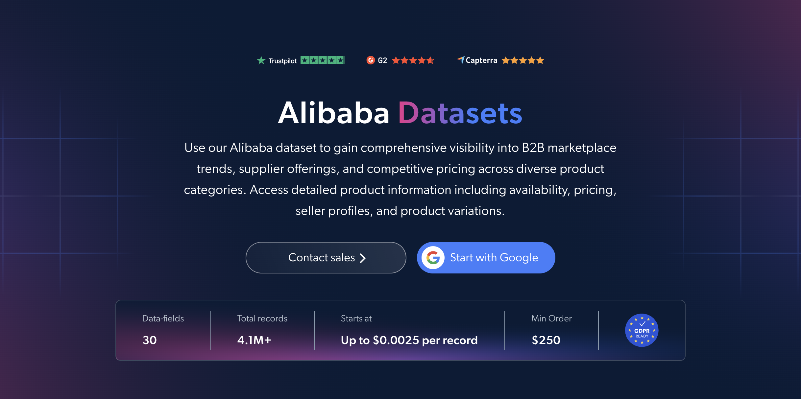

# Alibaba-dataset-sample
<h2>A sample dataset of 1000 Alibaba products</h2>

<a href="https://brightdata.com/products/datasets/alibaba">
   
</a>

An Alibaba dataset sample of 1000 products. Dataset was extracted using the <b>Bright Data API</b>.

<h2>Some of the data points that are included in the dataset:</h2>

* ```url```: URL of the Alibaba product page
* ```item_id```: Unique identifier for each product
* ```variant_id```: Unique identifier for each product variant
* ```title```: Title of the product
* ```description```: Full description of the product
* ```product_category```: Category of the product
* ```category_tree```: Category path of the product, with names and URLs
* ```brand```: Brand of the product
* ```image_url```: URL of the main product image
* ```price```: Regular price of the product
* ```sale_price```: Discounted price of the product
* ```availability```: Availability status, such as in stock, out of stock or pre-order
* ```variants```: All available variant options, grouped by type
* ```variant_attributes```: Attributes of the selected variant, such as color or size
* ```store_name```: Name of the supplier's store
* ```seller_url```: URL of the supplier's storefront
* ```store_country```: Country of the supplier's store
* ```return_window```: Number of days allowed for returns
* ```star_rating```: Average review score on a 0-5 scale
* ```review_count```: Number of product reviews
* ```reviews```: Customer reviews of the product

And a lot more.

This is a sample subset which is derived from the "Alibaba Products (public data)"
dataset which includes more than <b>4,100,000 products</b>.

Available dataset file formats: <b>JSON, NDJSON, JSON Lines, CSV, XLSX, or Parquet. Optionally, files can be compressed to .gz</b>.

Dataset delivery type options: <b>Email, API download, Webhook, Amazon S3, Google Cloud storage, Google Cloud PubSub, Microsoft Azure, Snowflake, SFTP</b>.

Update frequency: <b>Once, Daily, Weekly, Monthly, Quarterly, Biannual, or Custom basis</b>.

Data enrichment available as an addition to the data points extracted: <b>Based on request.</b>

<b>[Get the full Alibaba dataset](https://brightdata.com/products/datasets/alibaba)</b>.

<a href="https://brightdata.com/products/datasets/alibaba">
</a>

<h2>What are the Alibaba datasets use cases?</h2>

<h3>1. Wholesale price benchmarking</h3>
Businesses use Alibaba datasets to compare supplier prices for the same product type across categories. By benchmarking regular and sale prices, sourcing teams can estimate fair wholesale costs and negotiate better terms with manufacturers.

<h3>2. Supplier shortlisting</h3>
Retailers and procurement teams build shortlists of manufacturers and exporters by product line and store country. Links to each supplier's storefront make it easy to follow up and compare offerings before reaching out.

<h3>3. Buyer feedback on suppliers</h3>
Companies read star ratings and reviews alongside return terms to see how buyers judge product quality and supplier reliability. This helps reduce sourcing risk and spot trusted suppliers before placing an order.

<h2>Free access to web scraping tools and datasets for academic researchers and NGOs</h2>

The Bright Initiative offers access to Bright Data's <b>[Web Scraper APIs](https://brightdata.com/products/web-scraper)</b> and <b>[ready-to-use datasets](https://brightdata.com/products/datasets)</b> to leading academic faculties and researchers, NGOs and NPOs promoting various environmental and social causes. You can submit an application <b>[here](https://brightinitiative.com)</b>.
